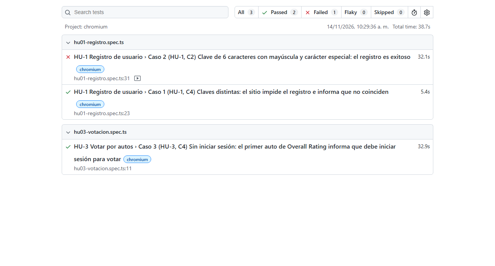

# QA Automation · Buggy Cars Rating

Pruebas de las historias de usuario HU-1, HU-2 y HU-3 sobre [Buggy Cars Rating](https://buggy.justtestit.org/): 3 casos automatizados con **Playwright + TypeScript** y 2 casos manuales.

Universidad Mariano Gálvez de Guatemala
Curso 048 · Aseguramiento de la Calidad del Software · III Serie

| Dato | Valor |
|------|-------|
| Estudiante | Guillermo Jose Gomez Aguilera |
| Carné | 1790-22-16429 |

## Navegador y herramientas

| Herramienta | Versión |
|-------------|---------|
| Navegador | **Chromium 149.0.7827.55** (perfil Desktop Chrome de Playwright) |
| Playwright | 1.61.1 |
| Node.js | v24.18.0 |
| npm | 11.16.0 |
| Sistema operativo | Windows 11 |

## Estructura del proyecto

```
buggy-cars-rating-playwright/
├── docs/
│   ├── casos-de-prueba.md      # Tabla de los 5 casos con su resultado
│   └── reporte-de-defectos.md  # Defectos encontrados
├── evidencias/                 # Capturas de la ejecución
├── pages/                      # Page Objects
│   ├── HomePage.ts
│   ├── ModelPage.ts
│   ├── OverallRatingPage.ts
│   └── RegisterPage.ts
├── tests/
│   ├── hu01-registro.spec.ts   # Casos 1 y 2
│   └── hu03-votacion.spec.ts   # Caso 3
├── .gitignore
├── .npmrc
├── package.json
├── playwright.config.ts
└── tsconfig.json
```

## Instalación

Requisitos: [Node.js](https://nodejs.org/) 18 o superior y Git.

```bash
git clone <url-del-repositorio>
cd <carpeta-del-repositorio>
npm install
npx playwright install chromium
```

> El archivo `.npmrc` tiene `ignore-scripts=true` por seguridad. Por eso el navegador no se descarga solo durante `npm install` y hay que instalarlo con `npx playwright install chromium`.

## Ejecución

```bash
# Todos los tests (se abre el navegador, headless: false)
npx playwright test

# Un archivo en particular
npx playwright test tests/hu01-registro.spec.ts
npx playwright test tests/hu03-votacion.spec.ts

# Reporte HTML de la última ejecución
npx playwright show-report

# Modo UI
npx playwright test --ui
```

También están los atajos `npm test`, `npm run report` y `npm run test:ui`.

## Casos de prueba

| Caso | HU | Criterio | Tipo | Resultado | Defecto |
|------|----|----------|------|-----------|---------|
| Caso 1 · Registro con confirmación de clave distinta | HU-1 | C4 | Automatizado | ✅ Pasa | — |
| Caso 2 · Registro con clave de 6 caracteres que cumple la historia | HU-1 | C2 | Automatizado | ❌ Falla | DEF-01 |
| Caso 3 · Votar sin iniciar sesión | HU-3 | C4 | Automatizado | ✅ Pasa | — |
| Caso 4 · Cambiar la clave por una de 8 caracteres | HU-2 | C2 | Manual | ❌ Falla | DEF-02 |
| Caso 5 · Guardar el perfil con el nombre vacío | HU-2 | C3 | Manual | ✅ Pasa | — |

> **El Caso 2 falla a propósito.** El sitio rechaza una clave que cumple la HU-1, y eso es un defecto. El test se dejó esperando el resultado que pide la historia, sin modificarlo para que pase. Al ejecutar la suite el resultado esperado es **2 passed, 1 failed**.

- Detalle de los casos: [docs/casos-de-prueba.md](docs/casos-de-prueba.md)
- Defectos: [docs/reporte-de-defectos.md](docs/reporte-de-defectos.md)

## Evidencia

Ejecución de los tests automatizados:



Las capturas de los casos manuales (Caso 4 y Caso 5) están en [evidencias/](evidencias/) y enlazadas en [docs/casos-de-prueba.md](docs/casos-de-prueba.md).
