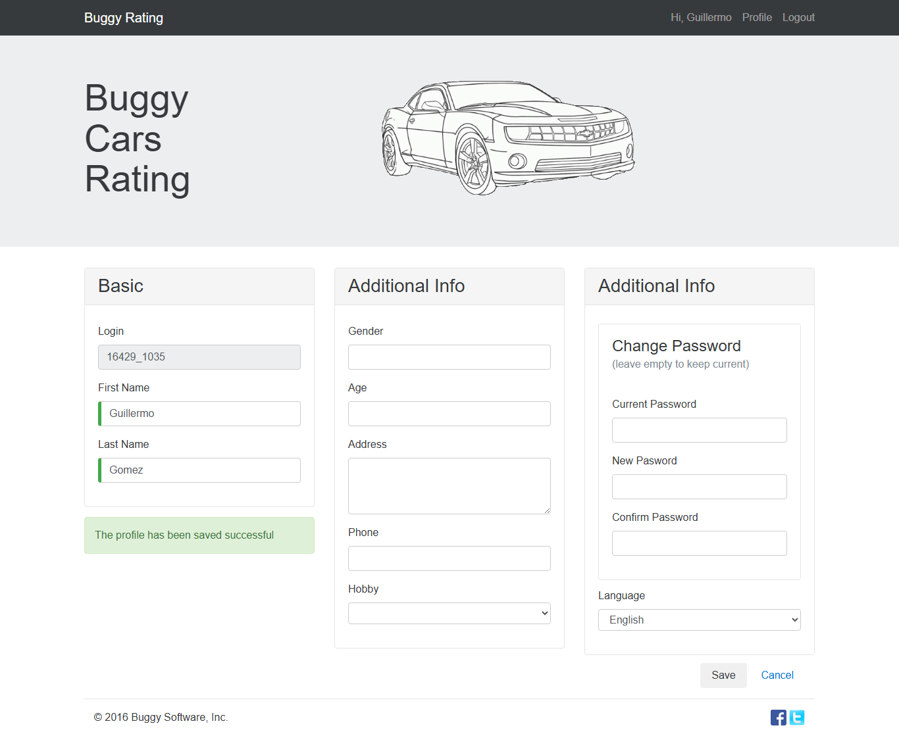
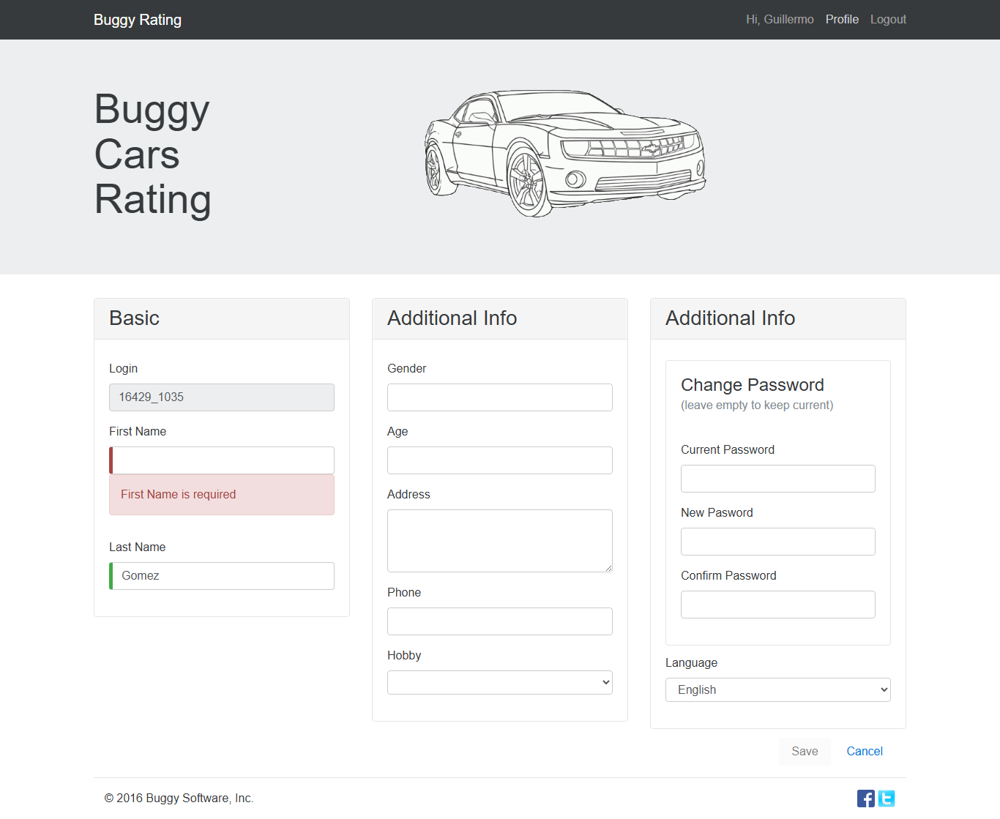

<div align="center">

# 🚗 Buggy Cars Rating · QA Testing

**Pruebas funcionales automatizadas y manuales sobre [Buggy Cars Rating](https://buggy.justtestit.org/)**


Universidad Mariano Gálvez de Guatemala · Aseguramiento de la Calidad del Software · III Serie

**Guillermo José Gómez Aguilera** · Carné 1790-22-16429

</div>

---

## 📋 Contenido

- [Sobre el proyecto](#-sobre-el-proyecto)
- [Historias de usuario](#-historias-de-usuario)
- [Casos de prueba](#-casos-de-prueba)
- [Defectos encontrados](#-defectos-encontrados)
- [Instalación](#-instalación)
- [Ejecución](#-ejecución)
- [Estructura del repositorio](#-estructura-del-repositorio)
- [Documentación y evidencias](#-documentación-y-evidencias)

---

## 🎯 Sobre el proyecto

Este repositorio reúne el plan de pruebas de tres historias de usuario del sitio Buggy Cars Rating:

- **3 casos automatizados** con Playwright y TypeScript, organizados con el patrón **Page Object Model**.
- **2 casos manuales** ejecutados en el navegador, con capturas de pantalla como evidencia.
- **Tabla de casos de prueba** en Excel y **reporte de defectos** en Word.

## 📖 Historias de usuario

| ID | Historia | Criterios probados |
|:--:|----------|--------------------|
| **HU-1** | **Registro de usuario.** Como usuario del sitio, quiero registrar mi usuario y mi clave para crear mis credenciales de acceso. | C2 · Clave de mínimo 6 caracteres con mayúscula y carácter especial<br>C4 · Ambas claves deben coincidir |
| **HU-2** | **Actualizar perfil.** Como usuario registrado, quiero actualizar mi perfil y mi clave para mantener mis datos al día. | C2 · Nueva clave de mínimo 10 caracteres con mayúscula, minúscula, número y carácter especial<br>C3 · Nombre y apellido son obligatorios |
| **HU-3** | **Votar por autos.** Como visitante o usuario, quiero votar por un auto para conocer los que más llaman la atención. | C4 · A quien no ha iniciado sesión se le informa que debe hacerlo para votar |

## 🧪 Casos de prueba

| Caso | Descripción | HU · Criterio | Tipo | Resultado |
|:----:|-------------|:-------------:|:----:|:---------:|
| **1** | Registro con una confirmación de clave distinta | HU-1 · C4 | 🤖 Automatizado | ✅ Pass |
| **2** | Registro con una clave de 6 caracteres que cumple la historia | HU-1 · C2 | 🤖 Automatizado | ❌ Fail · DEF-01 |
| **3** | Primer auto de Overall Rating sin iniciar sesión | HU-3 · C4 | 🤖 Automatizado | ✅ Pass |
| **4** | Cambio de clave en el perfil por una de 8 caracteres | HU-2 · C2 | 🖐️ Manual | ❌ Fail · DEF-02 |
| **5** | Guardar el perfil con el nombre vacío | HU-2 · C3 | 🖐️ Manual | ✅ Pass |

> [!NOTE]
> Los tests verifican el comportamiento que definen las historias de usuario. Cuando el sitio responde distinto, el resultado se registra como defecto. Por eso la ejecución de la suite muestra **2 passed · 1 failed**: el Caso 2 detecta el defecto DEF-01.

## 🐞 Defectos encontrados

| ID | Defecto | Origen | Severidad | Prioridad |
|:--:|---------|:------:|:---------:|:---------:|
| **DEF-01** | El registro rechaza una clave de 6 caracteres que cumple la HU-1 (el sitio exige 8) | Caso 2 | Alta | P1 |
| **DEF-02** | El perfil acepta una clave nueva de 8 caracteres, aunque la HU-2 pide mínimo 10 | Caso 4 | Alta | P2 |

## ⚙️ Instalación

**Requisitos:** [Node.js](https://nodejs.org/) 18 o superior y [Git](https://git-scm.com/).

```bash
# 1. Clonar el repositorio
git clone https://github.com/GuillermoGome2z/Examen-final-Playwright.git
cd Examen-final-Playwright

# 2. Instalar dependencias
npm install

# 3. Instalar el navegador
npx playwright install chromium
```

> [!TIP]
> El archivo `.npmrc` incluye `ignore-scripts=true` para instalar dependencias de forma segura. Por eso el navegador se instala en un paso aparte con `npx playwright install chromium`.

## ▶️ Ejecución

| Comando | Qué hace |
|---------|----------|
| `npx playwright test` | Ejecuta los 3 tests automatizados |
| `npx playwright test tests/hu01-registro.spec.ts` | Ejecuta los casos 1 y 2 |
| `npx playwright test tests/hu03-votacion.spec.ts` | Ejecuta el caso 3 |
| `npx playwright show-report` | Abre el reporte HTML de la última ejecución |
| `npx playwright test --ui` | Abre el modo interactivo de Playwright |

También están disponibles los atajos `npm test`, `npm run report` y `npm run test:ui`.

### 🌐 Navegador utilizado

| | |
|---|---|
| **Navegador** | Chromium 149.0.7827.55 (perfil *Desktop Chrome* de Playwright) |
| **Modo** | Con interfaz visible (`headless: false`) |
| **Sistema operativo** | Windows 11 |
| **Sitio** | https://buggy.justtestit.org |

## 📁 Estructura del repositorio

```
📦 Examen-final-Playwright
├── 📂 docs
│   ├── 📊 Casos_de_prueba_Buggy_Cars.xlsx     Tabla de casos de prueba
│   ├── 📝 Reporte_de_defectos_Buggy_Cars.docx Reporte de defectos
│   ├── casos-de-prueba.md                     Casos en Markdown con capturas
│   └── reporte-de-defectos.md                 Defectos en Markdown
├── 📂 evidencias                              Capturas de la ejecución
├── 📂 pages                                   Page Objects
│   ├── HomePage.ts
│   ├── ModelPage.ts
│   ├── OverallRatingPage.ts
│   └── RegisterPage.ts
├── 📂 tests
│   ├── hu01-registro.spec.ts                  Casos 1 y 2
│   └── hu03-votacion.spec.ts                  Caso 3
├── playwright.config.ts
├── package.json
├── tsconfig.json
├── .npmrc
└── .gitignore
```

## 📚 Documentación y evidencias

| Documento | Descripción |
|-----------|-------------|
| 📊 [Casos de prueba (Excel)](docs/Casos_de_prueba_Buggy_Cars.xlsx) | Los 5 casos con precondiciones, datos, pasos, resultado esperado y obtenido |
| 📝 [Reporte de defectos (Word)](docs/Reporte_de_defectos_Buggy_Cars.docx) | DEF-01 y DEF-02 con pasos para reproducir y evidencias |
| 📄 [Casos de prueba (Markdown)](docs/casos-de-prueba.md) | Versión para leer directamente en GitHub |
| 📄 [Reporte de defectos (Markdown)](docs/reporte-de-defectos.md) | Versión para leer directamente en GitHub |

### Ejecución automatizada

<div align="center">
  
</div>

### Casos manuales

<table>
  <tr>
    <th>Caso 4 · Clave de 8 caracteres aceptada</th>
    <th>Caso 5 · Nombre vacío rechazado</th>
  </tr>
  <tr>
    <td></td>
    <td></td>
  </tr>
</table>

Todas las capturas están en la carpeta [`evidencias/`](evidencias/).

---

<div align="center">

Hecho por **Guillermo José Gómez Aguilera** · UMG 2026

</div>
