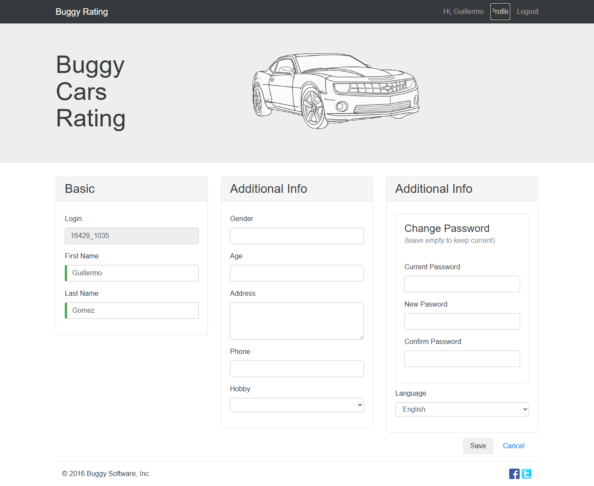
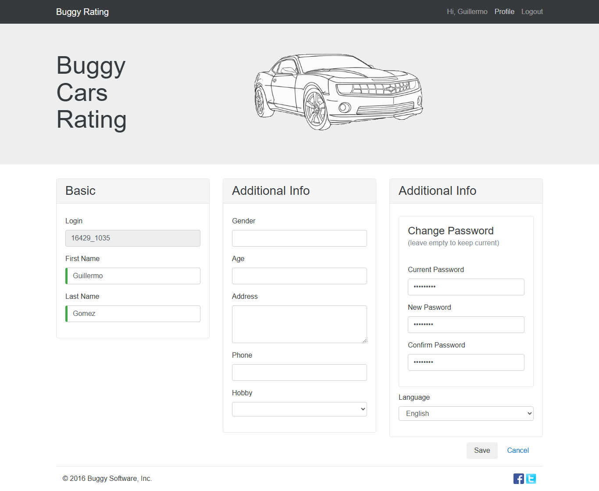
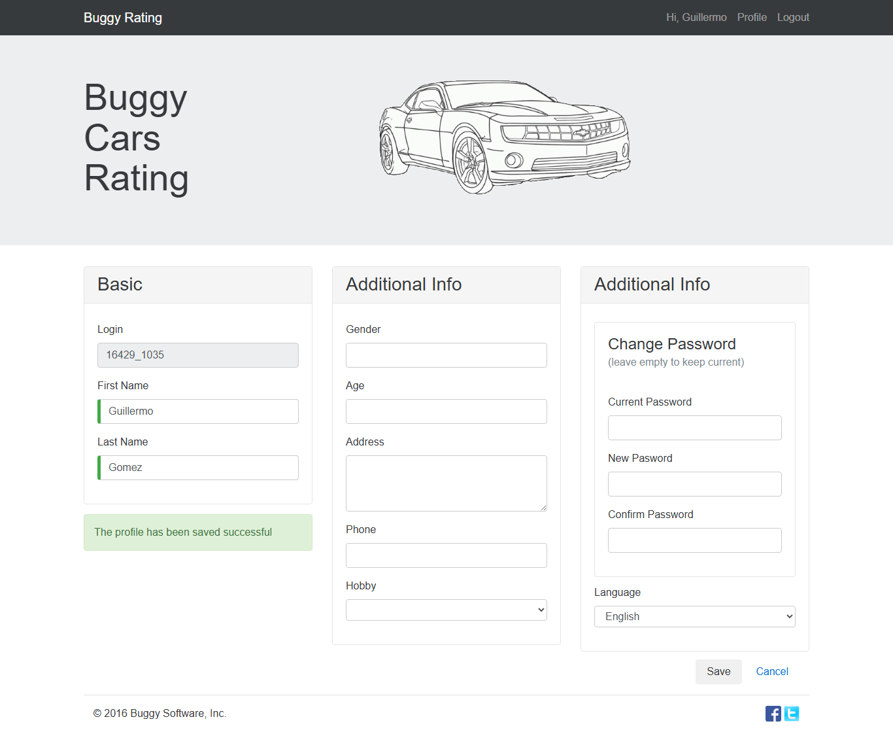
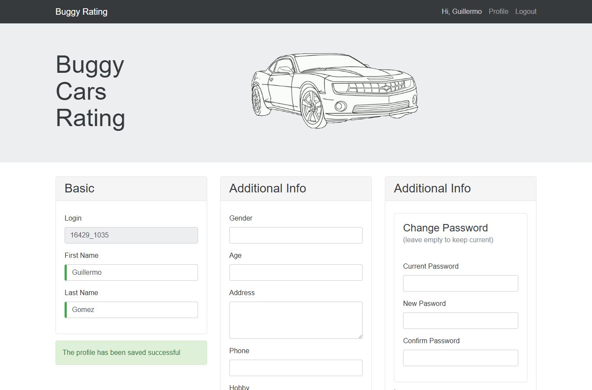
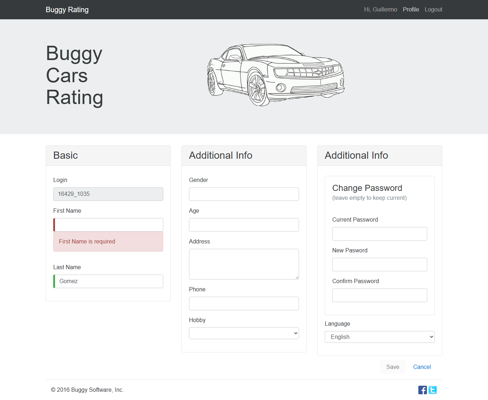

# Casos de prueba · Buggy Cars Rating

**Sitio bajo prueba:** https://buggy.justtestit.org/
**Fecha de ejecución:** 14/11/2026
**Navegador:** Chromium 149.0.7827.55 (Playwright 1.61.1)
**Ejecutado por:** Guillermo Jose Gomez Aguilera · Carné 1790-22-16429

## Historias de usuario

| ID | Historia de usuario | Criterios de aceptación |
|----|---------------------|-------------------------|
| HU-1 | **Registro de usuario.** Como usuario del sitio Buggy Cars Rating, quiero registrar mi usuario y mi clave, para poder crear mis credenciales de acceso. | C1. El registro solicita login, nombre, apellido y clave; todos los campos son obligatorios. C2. La clave debe tener mínimo 6 caracteres e incluir una letra mayúscula y un carácter especial. C3. Un usuario solo puede registrarse una vez. C4. Se debe confirmar la clave y ambas claves deben coincidir. |
| HU-2 | **Actualizar perfil de usuario.** Como usuario registrado, quiero actualizar mi perfil y mi clave, para poder mantener mis datos y mis credenciales al día. | C1. El perfil permite actualizar nombre, apellido, dirección, teléfono y hobby. C2. La nueva clave debe tener mínimo 10 caracteres e incluir mayúscula, minúscula, número y carácter especial. C3. Los campos nombre y apellido son obligatorios y no pueden quedar vacíos. |
| HU-3 | **Votar por autos.** Como visitante o usuario del sitio, quiero votar por un auto, para conocer cuáles son los que más llaman la atención. | C1. La votación solo está disponible para usuarios autenticados. C2. Un usuario solo puede votar una vez por cada auto. C3. El usuario puede dejar un comentario al votar. C4. A quien no ha iniciado sesión se le informa que debe hacerlo para votar. |

## Usuario de prueba

| Dato | Valor |
|------|-------|
| Login | `16429_1035` (carné + hora de creación) |
| First Name / Last Name | Guillermo / Gomez |
| Clave inicial | `Qa!16429x` |
| Clave después del Caso 4 | `Qa!1642x` |

> Al registrar el usuario, el sitio rechazó claves de 6 caracteres que cumplen la HU-1 (ver DEF-01). Para continuar se usó una clave que el sitio acepta (`Qa!16429x`).

## Resumen

| Caso | HU | Criterio | Tipo | Resultado | Defecto |
|------|----|----------|------|-----------|---------|
| Caso 1 | HU-1 | C4 | Automatizado | ✅ Pasa | — |
| Caso 2 | HU-1 | C2 | Automatizado | ❌ Falla | DEF-01 |
| Caso 3 | HU-3 | C4 | Automatizado | ✅ Pasa | — |
| Caso 4 | HU-2 | C2 | Manual | ❌ Falla | DEF-02 |
| Caso 5 | HU-2 | C3 | Manual | ✅ Pasa | — |

---

## Caso 1 · Registro con confirmación de clave distinta

| Campo | Detalle |
|-------|---------|
| **HU / Criterio** | HU-1 · C4 |
| **Tipo** | Automatizado · Negativo |
| **Archivo** | `tests/hu01-registro.spec.ts` |
| **Precondición** | No haber iniciado sesión |
| **Datos** | Login: `16429_<timestamp>` · First Name: `Guillermo` · Last Name: `Gomez` · Password: `Qa!16429x` · Confirm Password: `Qa!16429y` |

| Paso | Acción | Resultado esperado |
|------|--------|--------------------|
| 1 | Ingresar a `/register` | Se muestra el formulario de registro |
| 2 | Llenar Login, First Name, Last Name y Password con los datos | Los campos aceptan los valores |
| 3 | Escribir en Confirm Password una clave distinta y salir del campo | Aparece el mensaje "Passwords do not match" |
| 4 | Verificar el botón Register | El botón está deshabilitado: el sitio impide el registro |

**Resultado obtenido:** aparece "Passwords do not match" debajo de Confirm Password y el botón Register queda deshabilitado.
**Estado:** ✅ Pasa

---

## Caso 2 · Registro con clave de 6 caracteres que cumple la historia

| Campo | Detalle |
|-------|---------|
| **HU / Criterio** | HU-1 · C2 |
| **Tipo** | Automatizado · Positivo · Valor límite (mínimo 6 caracteres) |
| **Archivo** | `tests/hu01-registro.spec.ts` |
| **Precondición** | No haber iniciado sesión. Login no registrado previamente |
| **Datos** | Login: `16429_<timestamp>` · First Name: `Guillermo` · Last Name: `Gomez` · Password y Confirm Password: `Abc!12` (6 caracteres, mayúscula `A`, carácter especial `!`) |

| Paso | Acción | Resultado esperado |
|------|--------|--------------------|
| 1 | Ingresar a `/register` | Se muestra el formulario de registro |
| 2 | Llenar todos los campos con los datos | El botón Register se habilita |
| 3 | Hacer clic en Register | Aparece el mensaje verde "Registration is successful" |

**Resultado obtenido:** aparece el mensaje rojo "InvalidPasswordException: Password did not conform with policy: Password not long enough". El usuario no se registra.
**Estado:** ❌ Falla → **DEF-01**
**Evidencia:** [`evidencias/caso2-fallo-registro.png`](../evidencias/caso2-fallo-registro.png)

> El test no se modificó para que pase: sigue esperando el resultado que indica la historia.

---

## Caso 3 · Votar sin iniciar sesión

| Campo | Detalle |
|-------|---------|
| **HU / Criterio** | HU-3 · C4 |
| **Tipo** | Automatizado · Negativo |
| **Archivo** | `tests/hu03-votacion.spec.ts` |
| **Precondición** | No haber iniciado sesión |
| **Datos** | — |

| Paso | Acción | Resultado esperado |
|------|--------|--------------------|
| 1 | Ingresar a la página principal | Se muestra la página principal |
| 2 | Hacer clic en **Overall Rating** | Se muestra la tabla de autos en `/overall` |
| 3 | Hacer clic en el primer auto de la lista | Se abre la página del modelo |
| 4 | Revisar la sección de votación | Aparece "You need to be logged in to vote." y no hay botón Vote! |

**Resultado obtenido:** se abre el primer auto (Lamborghini Diablo) y aparece "You need to be logged in to vote."; el botón Vote! no se muestra.
**Estado:** ✅ Pasa

---

## Caso 4 · Cambiar la clave por una de 8 caracteres

| Campo | Detalle |
|-------|---------|
| **HU / Criterio** | HU-2 · C2 |
| **Tipo** | Manual · Negativo · Valor límite (mínimo 10 caracteres) |
| **Precondición** | Usuario `16429_1035` registrado con la clave `Qa!16429x` |
| **Datos** | Current Password: `Qa!16429x` · New Password y Confirm Password: `Qa!1642x` (8 caracteres: mayúscula, minúscula, número y carácter especial) |

| Paso | Acción | Resultado esperado |
|------|--------|--------------------|
| 1 | Iniciar sesión con `16429_1035` / `Qa!16429x` | Se muestra "Hi, Guillermo" en la barra |
| 2 | Hacer clic en **Profile** | Se muestra el formulario del perfil |
| 3 | Llenar Current Password, New Password y Confirm Password con los datos | Los campos aceptan los valores |
| 4 | Hacer clic en **Save** | El sitio rechaza la clave porque tiene menos de 10 caracteres |
| 5 | Cerrar sesión e iniciar sesión con la clave nueva `Qa!1642x` | No debe ser posible: la clave no se cambió |

**Resultado obtenido:** aparece el mensaje verde "The profile has been saved successful". La clave cambia a `Qa!1642x` y se puede iniciar sesión con ella.
**Estado:** ❌ Falla → **DEF-02**

**Evidencia:**

| Paso | Captura |
|------|---------|
| Perfil antes del cambio |  |
| Clave de 8 caracteres ingresada |  |
| Perfil guardado con éxito |  |
| Inicio de sesión con la clave nueva |  |

---

## Caso 5 · Guardar el perfil con el nombre vacío

| Campo | Detalle |
|-------|---------|
| **HU / Criterio** | HU-2 · C3 |
| **Tipo** | Manual · Negativo |
| **Precondición** | Usuario `16429_1035` con sesión iniciada |
| **Datos** | First Name: *(vacío)* |

| Paso | Acción | Resultado esperado |
|------|--------|--------------------|
| 1 | Iniciar sesión e ingresar a **Profile** | Se muestra el perfil con First Name "Guillermo" |
| 2 | Borrar el contenido de First Name y salir del campo | Aparece el mensaje "First Name is required" |
| 3 | Intentar hacer clic en **Save** | El botón está deshabilitado y el perfil no se guarda |

**Resultado obtenido:** aparece "First Name is required" debajo del campo, el borde se marca en rojo y el botón Save queda deshabilitado; el perfil no se guarda.
**Estado:** ✅ Pasa

**Evidencia:**

| Paso | Captura |
|------|---------|
| Perfil antes del cambio |  |
| First Name vacío y Save deshabilitado |  |
