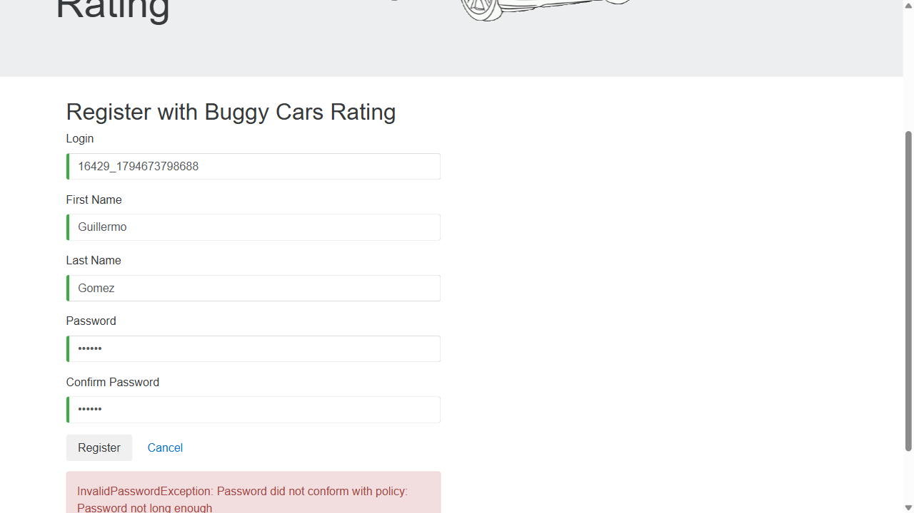
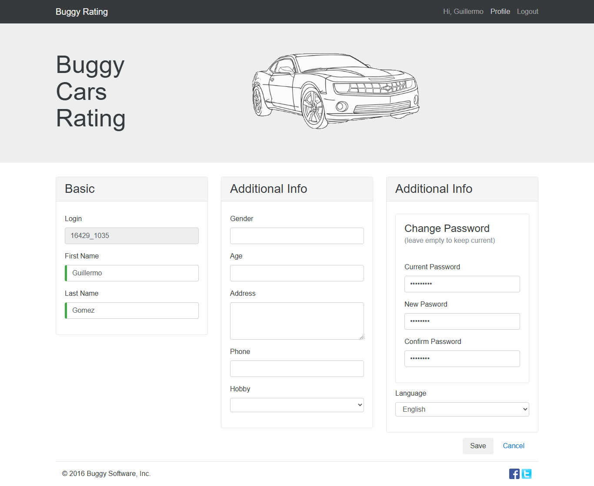
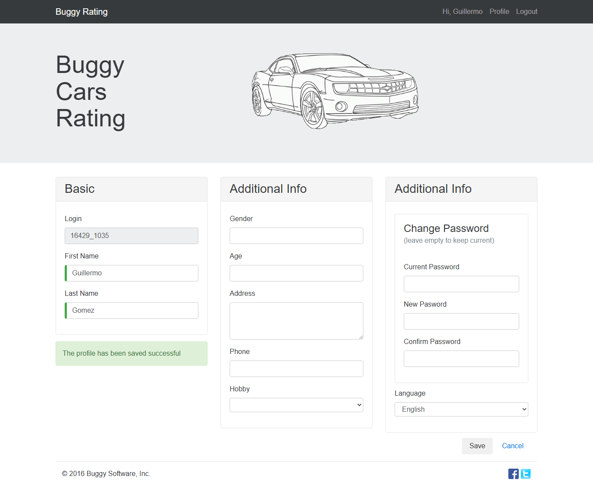
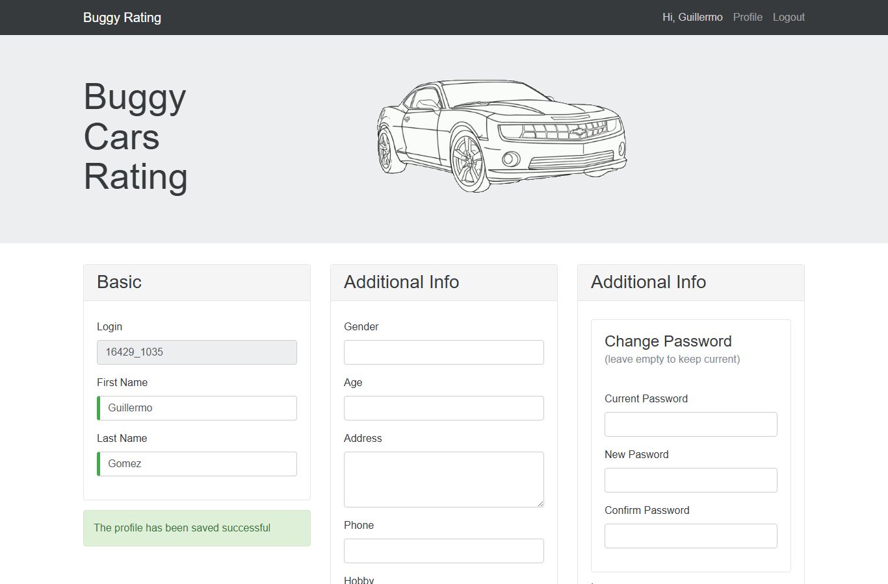

# Reporte de defectos · Buggy Cars Rating

**Sitio bajo prueba:** https://buggy.justtestit.org/
**Navegador:** Chromium 149.0.7827.55 (Playwright 1.61.1) · Windows 11
**Reportado por:** Guillermo Jose Gomez Aguilera · Carné 1790-22-16429
**Fecha:** 14/11/2026

| ID | Título | Caso | Severidad | Prioridad | Estado |
|----|--------|------|-----------|-----------|--------|
| DEF-01 | El registro rechaza una clave de 6 caracteres que cumple la HU-1 | Caso 2 | Alta | Alta | Abierto |
| DEF-02 | El perfil acepta una clave nueva de menos de 10 caracteres | Caso 4 | Alta | Alta | Abierto |

---

## DEF-01 · El registro rechaza una clave de 6 caracteres que cumple la HU-1

| Campo | Detalle |
|-------|---------|
| **Historia / Criterio** | HU-1 · C2: la clave debe tener mínimo 6 caracteres e incluir una letra mayúscula y un carácter especial |
| **Caso de prueba** | Caso 2 (automatizado) · `tests/hu01-registro.spec.ts` |
| **Severidad** | Alta |
| **Prioridad** | Alta |
| **Ambiente** | https://buggy.justtestit.org/register · Chromium 149 · Windows 11 |
| **Precondición** | No haber iniciado sesión |

**Pasos para reproducir**

1. Ingresar a https://buggy.justtestit.org/register
2. Login: `16429_<timestamp>`, First Name: `Guillermo`, Last Name: `Gomez`
3. Password y Confirm Password: `Abc!12`
4. Hacer clic en **Register**

**Resultado esperado:** "Registration is successful", porque la clave tiene 6 caracteres, una mayúscula y un carácter especial.

**Resultado obtenido:** mensaje rojo "InvalidPasswordException: Password did not conform with policy: Password not long enough". El usuario no se registra.

**Observaciones:** en pruebas exploratorias el sitio exige en realidad mínimo **8 caracteres**, además de **minúscula** y **número**, que el criterio C2 no pide. El mensaje muestra el nombre técnico de la excepción del servidor en lugar de un texto claro para el usuario.

**Evidencia:** 

---

## DEF-02 · El perfil acepta una clave nueva de menos de 10 caracteres

| Campo | Detalle |
|-------|---------|
| **Historia / Criterio** | HU-2 · C2: la nueva clave debe tener mínimo 10 caracteres e incluir mayúscula, minúscula, número y carácter especial |
| **Caso de prueba** | Caso 4 (manual) |
| **Severidad** | Alta |
| **Prioridad** | Alta |
| **Ambiente** | https://buggy.justtestit.org/profile · Chromium 149 · Windows 11 |
| **Precondición** | Usuario `16429_1035` registrado con la clave `Qa!16429x` |

**Pasos para reproducir**

1. Iniciar sesión con `16429_1035` / `Qa!16429x`
2. Hacer clic en **Profile**
3. Current Password: `Qa!16429x`
4. New Password y Confirm Password: `Qa!1642x` (8 caracteres)
5. Hacer clic en **Save**
6. Cerrar sesión e iniciar sesión con `Qa!1642x`

**Resultado esperado:** el sitio rechaza la clave nueva por tener menos de 10 caracteres y la clave actual no cambia.

**Resultado obtenido:** aparece "The profile has been saved successful", la clave cambia y se puede iniciar sesión con `Qa!1642x`.

**Impacto:** se permiten claves más débiles que las definidas en la historia. Además, la política de claves es distinta en el registro (DEF-01) y en el perfil.

**Evidencia**

| Clave de 8 caracteres ingresada | Perfil guardado con éxito | Inicio de sesión con la clave nueva |
|---|---|---|
|  |  |  |
